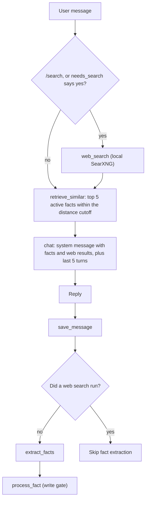
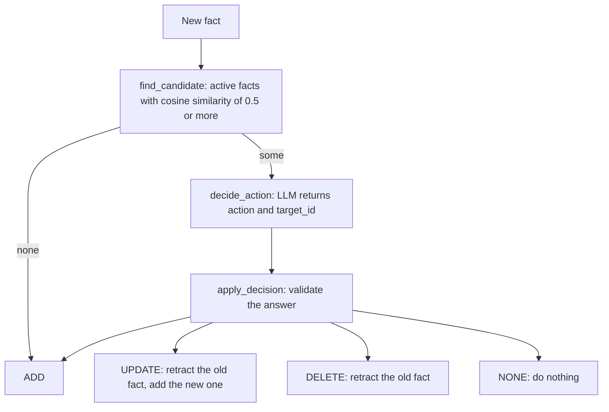
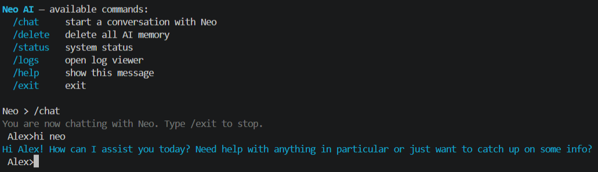
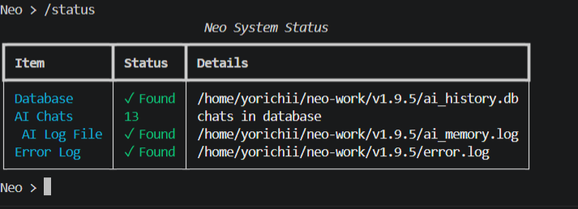
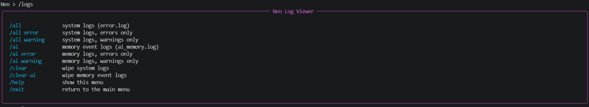
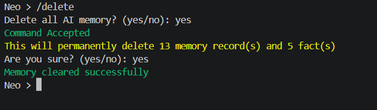

# Neo AI — v1.9.5

**Co-engineered with Claude (Anthropic): design, code review, debugging, tests and documentation. Claude also wrote some pieces directly (for example the docstrings, the stress-test script and the search-gate function). v1.9.5 was rebuilt step by step from v1.8.5; the v1.9 it replaces was largely written with Claude.**

[](https://www.python.org/)
[](https://opensource.org/licenses/MIT)
[](https://ollama.com/)

A fully local AI assistant with memory that persists across sessions. Neo pulls facts out of what you say, decides whether each one is new, a change, or a repeat, and keeps a clean list of what is currently true about you. Live web search is optional, runs through your own SearXNG container, and is never written into memory. No cloud. No API keys. Your memory never leaves your machine.

> **Disclaimer:** Neo runs a local LLM. Like all language models, it can make mistakes, hallucinate, or produce incorrect information. Do not rely on it for critical decisions.

---

## What's new in v1.9.5

- **One flat `facts` table.** Each fact is a sentence with a status (`active` or `retracted`). Nothing is overwritten; a changed fact is retracted and the new one is added.
- **A write gate with one decision step.** For every new fact, Neo finds similar active facts (cosine similarity of 0.5 or more), then the LLM answers ADD, UPDATE, DELETE or NONE, and plain code validates that answer before anything is written.
- **Automatic fact extraction.** `extract_facts` turns a message into facts. Questions, greetings and filler produce none.
- **Retrieval reads facts.** The chat reply is given the 5 closest active facts, filtered by a distance cutoff, instead of old conversation turns. Retracted facts never come back.
- **Web search on demand.** `/search <query>` forces a search, and an LLM check (`needs_search`) triggers one on its own for questions about recent or changing things. Results go to the reply only.
- **Tested.** 26 pytest tests, plus a 65-turn stress test (50 facts) described below.

---

## v1.9 vs v1.9.5

v1.9.5 is a rebuild from v1.8.5, not a patch on v1.9. v1.9's entity attributes were hard to keep consistent: in testing, retractions on workplace did not hold, and education was dropped after a correction. The goal of v1.9.5 was the same memory behaviour with far fewer moving parts.

| | v1.9 | v1.9.5 |
|---|---|---|
| Memory model | Entity tables (`entity_attrs`, `entity_mentions`, `semantic_memory`) | One `facts` table plus `ai_history` |
| Write gate | Three layers: gazetteer, LLM plausibility, cosine contradiction at 0.8 | Candidate lookup at cosine 0.5, then one LLM decision (ADD, UPDATE, DELETE, NONE), validated in code |
| Fact extraction | spaCy and YAKE | LLM (`extract_facts`) |
| Retrieval | Fusion of Jaccard, entity and vector scores, HNSW index | Vector search on the full prompt, top 5 within a distance cutoff |
| Embeddings | Local sentence-transformer (`all-mpnet-base-v2`) | `nomic-embed-text` through Ollama |
| Web search | SearXNG, Brave or Tavily, query classifier, cached results | One local SearXNG URL, LLM gate, no cache |
| Extras | Hardware-aware context sizing, consolidation, backfill | Dropped on purpose |
| Tests | `tests/test_fixes.py` | `test_facts.py`, 26 tests |

v1.9 reported Recall@4 of 0.94 and MRR of 0.88 on its retrieval eval. v1.9.5 has no equivalent benchmark: its retrieval was tuned and checked with the stress test below.

---

## Architecture

### Chat turn



### Write gate



`apply_decision` falls back to ADD if the LLM names an unknown action or a target that is not among the candidates. An UPDATE onto an identical fact becomes NONE.

### Storage

| Store | Role |
|---|---|
| SQLite (`ai_history.db`) | Source of truth: chat history (`ai_history`) and facts (`facts`) |
| LanceDB (`lance_store/`) | Vector store: one embedding per fact and per chat turn, keyed by ID |

Web results are never stored.

---

## Stress test

A 65-turn script (`harder_test_1.py`, then `harder_test_2.py` as a fresh process) feeds Neo 50 facts and 15 chat-only turns. It includes a location history: born, schooled and first job in Bengaluru, then moves through Germany, a made-up country, and France, ending in Zurich.

What it showed:

- Each move retracted the previous current location, while born, schooled and first job stayed active.
- Facts about other people (mother, father, sister) were not retracted by the moves.
- Explicit "forget" requests, and stopped or sold items, retracted the old fact.
- None of the 15 chat-only turns created a fact.
- No retracted fact ever came back through retrieval, including after a restart.

It also found real limits, listed below.

---

## Known Issues

Full list in [`KNOWN_ISSUES.md`](KNOWN_ISSUES.md). Short version:

- **Comparative preferences are not extracted.** "I like X more than Y" produces no fact.
- **Some sentences split into fragments.** "I want to work in machine learning in Europe" can be stored as two facts, and the second can retract the first.
- **The retrieval cutoff is loose at larger fact counts.** It was tuned on 8 facts; at about 50, an unrelated question can pull in a loosely related fact.
- **Follow-up web searches lose context.** The raw message is the search query.
- **The extractor and the gate depend on the model.** They run on `llama3.1` 8B and can misjudge unusual wording.

---

## Project Structure

```
neo-AI/
├── main.py            # Entry point, command loop, Ollama auto-start
├── neo.py             # Chat loop, delete memory, fact saving
├── neo_ollama.py      # LLM calls: chat, embeddings, write-gate decision, fact extraction, search check
├── storage.py         # SQLite, facts, candidate lookup, write gate, retrieval
├── lancedb_store.py   # LanceDB insert, similarity search, clear
├── web_search.py      # SearXNG client
├── config.py          # First-run username setup
├── logger.py          # Dual logger (system + memory), log viewer CLI
├── file_data.py       # System status checker
└── test_facts.py      # pytest suite
```

## Screenshots and Demos

### Demos


### Chat


### System Status


### Logs


### Memory Delete


---

## Database Schema

```sql
CREATE TABLE ai_history (
    id                  INTEGER PRIMARY KEY AUTOINCREMENT,
    prompt              TEXT NOT NULL,
    response            TEXT NOT NULL,
    timestamp           TEXT NOT NULL,
    compressed_keywords TEXT,
    embeddings_id       TEXT
);

CREATE TABLE facts (
    id           INTEGER PRIMARY KEY AUTOINCREMENT,
    fact_text    TEXT NOT NULL,
    created_at   TEXT NOT NULL,
    status       TEXT NOT NULL,      -- 'active' or 'retracted'
    embedding_id TEXT,               -- UUID of the vector in LanceDB
    retracted_at TEXT
);
```

<!--
## Screenshots and Demos
Re-record these on v1.9.5 before enabling: the older GIFs and screenshots show v1.9 behaviour.
-->

---

## Setup

**Requirements:** Python 3.12+, [Ollama](https://ollama.com/), and optionally [Docker](https://www.docker.com/) for web search.

```bash
git clone https://github.com/Neo-X7/neo-AI.git
cd neo-AI
pip install ollama lancedb pyarrow yake rich httpx requests pytest
```

Pull the two models:

```bash
ollama pull llama3.1
ollama pull nomic-embed-text
```

**Web search (optional).** Run one SearXNG container on port 8888 with JSON output enabled (`search.formats` in its `settings.yml`):

```bash
docker run -d --name searxng -p 8888:8080 searxng/searxng
```

If SearXNG is not running, Neo still works: web search returns nothing, and the error is logged to `error.log`.

Run:

```bash
python main.py
```

Neo starts the Ollama server automatically if it isn't running. Run the tests from the project folder with `pytest -q`.

---

## Commands

**Main menu:**

```
/chat      start a conversation
/delete    wipe all memory (chat history, facts and vectors)
/status    system status
/logs      open log viewer
/help      show commands
/exit      exit
```

**Inside `/chat`:**

```
/search <query>   force a web search (Neo also searches on its own when needed)
/exit             return to main menu
```

**Inside `/logs`:**

```
/all [error|warning]   system logs
/ai [error|warning]    memory event logs
/clear                 wipe system logs
/clear-ai              wipe memory event logs
/help                  show the menu
/exit                  return to main menu
```

---

## Version History

| Version | Changes |
|---|---|
| v1.0 – v1.7 | Initial CLI build, JSON to SQLite migration, logging, pytest suite |
| v1.8 | Local LLM via Ollama, LanceDB vector store, semantic memory retrieval |
| v1.8.5 | Bug fixes across logging, delete logic, embedding guards |
| v1.9 | Entity memory, three-layer write gate, fusion retrieval, multi-backend web search |
| **v1.9.5** | Rebuild from v1.8.5: flat facts table, LLM fact extraction, one-step write gate, fact retrieval with a distance cutoff, on-demand SearXNG web search, 26-test suite and a 65-turn stress test |

---

## Project Status

v1.9.5 is the final release of this repository. Neo's design assumes a machine that can run `llama3.1` 8B locally, which is not a realistic baseline for a packaged, download-and-run product, so no further versions are planned here.