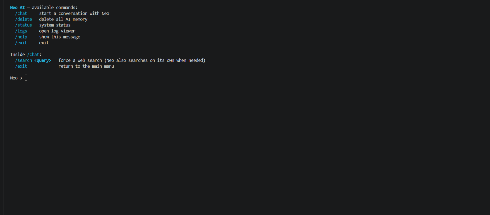
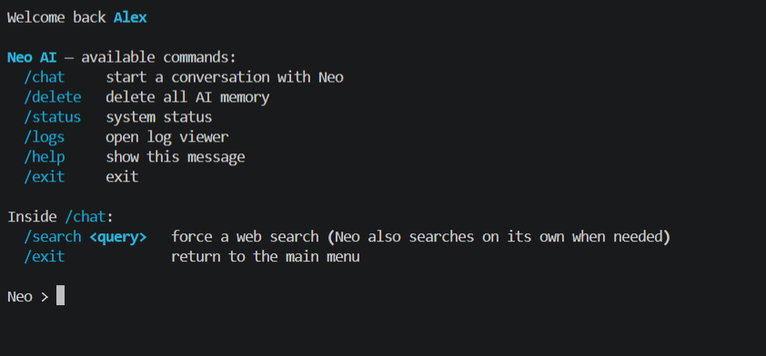
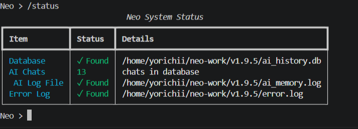
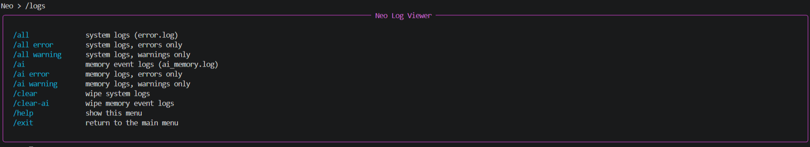
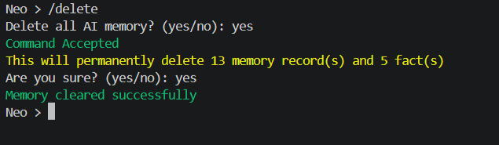
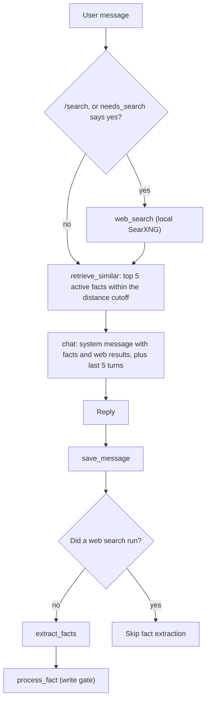
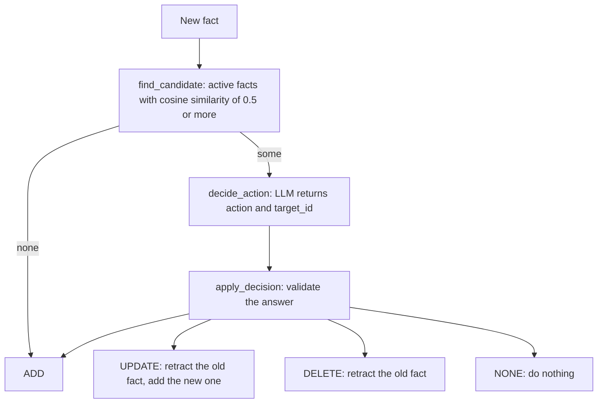

# Neo

**A fully local AI assistant that remembers what's true about you, and notices when it changes.**

No cloud. No API keys. Your memory never leaves your machine.

[](https://www.python.org/)
[](LICENSE)
[](https://ollama.com/)



Neo pulls facts out of what you say, decides whether each one is **new**, a **change**, or a **repeat**, and keeps a clean list of what is currently true. Nothing is overwritten: a changed fact is retracted, and the new one is added. Live web search is optional, runs through your own SearXNG container, and is never written into memory.

**How Neo differs:** plain RAG retrieves stored text but never reconciles it, so old and new facts sit side by side. Mem0 also makes add/update/delete decisions, but defaults to hosted LLMs. Neo runs entirely on local models, keeps retracted facts as a non-destructive record, and measures its write gate on a labeled eval set ([results below](#evaluation)).

> Neo runs a local 8B model. It can make mistakes or hallucinate. Don't rely on it for critical decisions.

---

## See it work

```
You:  I live in Munich.
      → fact added: "lives in Munich"

You:  I moved to Zurich last month.
      → "lives in Munich" retracted
      → fact added: "lives in Zurich"

You:  Where am I from?        (born in Bengaluru, stated earlier)
Neo:  answers from active facts only. Munich never comes back.
```

This is the behaviour the [stress test](#stress-test) checks over 65 turns, including after a restart.

### Screenshots









---

## Quick start

**Requirements:** Python 3.12+, [Ollama](https://ollama.com/), and optionally [Docker](https://www.docker.com/) for web search.

```bash
git clone https://github.com/Neo-X7/neo-AI.git
cd neo-AI
pip install -r requirements.txt
ollama pull llama3.1
ollama pull nomic-embed-text
python main.py
```

Neo starts the Ollama server for you if it isn't running.

**Web search (optional).** Run one SearXNG container with JSON output enabled (`search.formats` in its `settings.yml`):

```bash
docker run -d --name searxng -p 8888:8080 searxng/searxng
```

Without it, Neo still works. Web search returns nothing and the error goes to `error.log`.

Tests: `pytest -q` from the project folder.

---

## How it works

### Chat turn



### Write gate

For every new fact, Neo finds similar active facts (cosine similarity of 0.5 or more). The LLM answers ADD, UPDATE, DELETE or NONE, and plain code validates the answer before anything is written.



`apply_decision` falls back to ADD if the LLM names an unknown action or a target that isn't among the candidates. An UPDATE onto an identical fact becomes NONE.

### Storage

| Store | Role |
|---|---|
| SQLite (`ai_history.db`) | Source of truth: chat history (`ai_history`) and facts (`facts`) |
| LanceDB (`lance_store/`) | Vector store: one embedding per fact and per chat turn |

Web results are never stored.

---

## Evaluation

### Write-gate eval

`gate_eval.json` holds 30 labeled cases (existing facts, a new fact, the expected action). `test_gate.py` runs each case against a fresh SQLite DB and a fresh LanceDB table, through the real `process_fact` path, and reports the correct-action rate.

**Baseline: 22/28 (78.6%)**, single run on `llama3.1` 8B.

- 2 cases are excluded: "Stop remembering my location" and "Ignore that, I never said that". They are commands rather than facts, so the gate has nothing to match them against. Listed under known issues.
- Cases where retracting is as acceptable as deleting ("quit their job", "sold the laptop", "doesn't like tea anymore") accept either action.

| Category | Correct |
|---|---|
| repeat | 4/4 |
| other_person | 4/4 |
| job, location, forget, coexist | all correct |
| fragment | 1/3 |
| past tense | 0/1 |
| multi-existing | 0/1 |

Run it with `python test_gate.py` (Ollama must be running). It uses separate test stores (`test_gate.db`, `lance_test/`), so your real memory is untouched.

### Stress test

A 65-turn script (`harder_test_1.py`, then `harder_test_2.py` as a fresh process) feeds Neo 50 facts and 15 chat-only turns, including a location history that ends in Zurich.

- Each move retracted the previous current location. Born, schooled and first job stayed active.
- Facts about other people (mother, father, sister) were not retracted by the moves.
- Explicit "forget" requests, and stopped or sold items, retracted the old fact.
- None of the 15 chat-only turns created a fact.
- No retracted fact came back through retrieval, including after a restart.

### Retrieval eval

`eval_neo.py` seeds 10 facts into an isolated temporary SQLite + LanceDB store, queries `retrieve_similar` with 10 paraphrased prompts, and checks retracted-fact leakage after updates/deletes (`nomic-embed-text` + `llama3.1` 8B).

| Metric | Result |
|---|---|
| Recall@1 | 0.70 (7/10) |
| Recall@3 | 0.80 (8/10) |
| Recall@5 | 0.80 (8/10) |
| MRR | 0.75 |
| Avg retrieval latency | 30.1 ms |
| Write-gate smoke cases | 5/5 (100%) |
| Retracted-fact leakage | 0/3 |

---

## Known issues

Full list in [`KNOWN_ISSUES.md`](KNOWN_ISSUES.md). The first three are measured by the write-gate eval.

- **Fragments can retract unrelated facts.** "I want to work in machine learning in Europe" can split into two facts, and the second can retract the first or an unrelated fact such as your location (2 of 3 eval cases fail).
- **Past-tense facts retract current ones.** "I used to live in Chennai" can retract "lives in Bengaluru". The decision prompt has no rule for past tense.
- **Retrieval can miss a related fact.** If the candidate lookup finds nothing at 0.5, the gate defaults to ADD without asking the LLM.
- **"Forget" commands aren't matched.** "Stop remembering my location" has no content similar to the stored fact, so it never reaches the LLM.
- **Comparative preferences aren't extracted.** "I like X more than Y" produces no fact.
- **The retrieval cutoff is loose at larger fact counts.** It was tuned on 8 facts. At about 50, an unrelated question can pull in a loosely related fact.
- **Follow-up web searches lose context.** The raw message is the search query.
- **Quality depends on the model.** Extraction and the gate run on `llama3.1` 8B and can misjudge unusual wording.

---

## Why a rebuild (v1.9 → v1.9.5)

v1.9.5 is a rebuild from v1.8.5, not a patch on v1.9. In testing, v1.9's entity attributes were hard to keep consistent: retractions on workplace didn't hold, and education was dropped after a correction. The goal was the same memory behaviour with far fewer moving parts.

| | v1.9 | v1.9.5 |
|---|---|---|
| Memory model | Entity tables (`entity_attrs`, `entity_mentions`, `semantic_memory`) | One `facts` table plus `ai_history` |
| Write gate | Gazetteer, LLM plausibility, cosine contradiction at 0.8 | Candidate lookup at 0.5, one LLM decision, validated in code |
| Fact extraction | spaCy and YAKE | LLM (`extract_facts`) |
| Retrieval | Jaccard, entity and vector fusion, HNSW index | Vector search on the full prompt, top 5 within a distance cutoff |
| Embeddings | `all-mpnet-base-v2` (local) | `nomic-embed-text` through Ollama |
| Web search | SearXNG, Brave or Tavily, classifier, cache | One local SearXNG URL, LLM gate, no cache |
| Extras | Hardware-aware context sizing, consolidation, backfill | Dropped on purpose |
| Tests | `tests/test_fixes.py` | `test_facts.py` (26 tests), `test_gate.py` (write-gate eval) |

v1.9 reported Recall@4 of 0.94 and MRR of 0.88 on its retrieval eval. v1.9 reported Recall@4 of 0.94 and MRR of 0.88 on its retrieval eval. v1.9.5 measures Recall@5 of 0.80 and MRR of 0.75 on `eval_neo.py` (10 queries, `30.1 ms` avg) with 0/3 retracted-fact leakage, alongside the 65-turn stress test above.

---

## Commands

**Main menu:** `/chat` · `/delete` (wipes chat history, facts and vectors) · `/status` · `/logs` · `/help` · `/exit`

**Inside `/chat`:** `/search <query>` forces a web search (Neo also searches on its own when needed) · `/exit`

**Inside `/logs`:** `/all [error|warning]` · `/ai [error|warning]` · `/clear` · `/clear-ai` · `/help` · `/exit`

---

## Project structure

```
neo-AI/
├── main.py            # Entry point, command loop, Ollama auto-start
├── neo.py             # Chat loop, delete memory, fact saving
├── neo_ollama.py      # LLM calls: chat, embeddings, write-gate decision, extraction, search check
├── storage.py         # SQLite, facts, candidate lookup, write gate, retrieval
├── lancedb_store.py   # LanceDB insert, similarity search, clear
├── web_search.py      # SearXNG client
├── config.py          # First-run username setup
├── logger.py          # Dual logger (system + memory), log viewer CLI
├── file_data.py       # System status checker
├── test_facts.py      # pytest suite
├── test_gate.py       # Write-gate eval runner
└── gate_eval.json     # 30 labeled write-gate cases
```

<details>
<summary>Database schema</summary>

```sql
CREATE TABLE ai_history (
    id                  INTEGER PRIMARY KEY AUTOINCREMENT,
    prompt              TEXT NOT NULL,
    response            TEXT NOT NULL,
    timestamp           TEXT NOT NULL,
    compressed_keywords TEXT,
    embeddings_id       TEXT
);

CREATE TABLE facts (
    id           INTEGER PRIMARY KEY AUTOINCREMENT,
    fact_text    TEXT NOT NULL,
    created_at   TEXT NOT NULL,
    status       TEXT NOT NULL,      -- 'active' or 'retracted'
    embedding_id TEXT,               -- UUID of the vector in LanceDB
    retracted_at TEXT
);
```

</details>

---

## Version history

| Version | Changes |
|---|---|
| v1.0 – v1.7 | Initial CLI build, JSON to SQLite migration, logging, pytest suite |
| v1.8 | Local LLM via Ollama, LanceDB vector store, semantic memory retrieval |
| v1.8.5 | Bug fixes across logging, delete logic, embedding guards |
| v1.9 | Entity memory, three-layer write gate, fusion retrieval, multi-backend web search |
| **v1.9.5** | Rebuild from v1.8.5: flat facts table, LLM extraction, one-step write gate, distance-cutoff retrieval, on-demand SearXNG search, 26 tests, 65-turn stress test, labeled write-gate eval |

## Project status

**Active development.** v1.9.5 is a rebuild focused on a validated, measurable memory write gate, and the eval above is the baseline for what comes next:

1. Fix fragment-safe fact extraction, so a split sentence can't retract its own first half.
2. Add a past-tense rule to the gate prompt.
3. Detect "forget" intent before the similarity search.
4. Tune the 0.5 candidate threshold against the eval (0.4 / 0.5 / 0.7) and publish the comparison.

## Built with Claude

Neo was co-engineered with Claude (Anthropic): design, code review, debugging, tests and documentation. Claude also wrote some pieces directly, such as the docstrings, the stress-test script and the search-gate function. v1.9.5 was rebuilt step by step from v1.8.5, and the v1.9 it replaces was largely written with Claude.